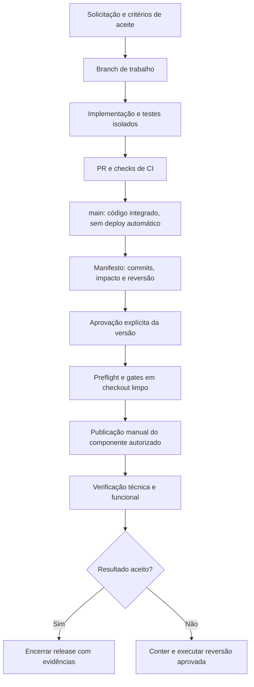

# Fluxo formal de implementação e publicação — Faith Hubs

**Versão:** 1.0 · **Data:** 12/11/2026 · **Responsável pela decisão de liberação:** proprietário do produto ou pessoa formalmente designada.

> **Condição operacional identificada nesta implantação:** foi encontrada dependência comprometida no backend. Antes de qualquer nova liberação de produção, concluir a avaliação da máquina e a rotação de credenciais em dispositivo confiável. Ver [registro e ações pendentes](DEPENDENCIAS_E_RESPOSTA_INCIDENTE_2026-11-12.md). O bloqueio de publicação automática permanece ativo.

## 1. Objetivo e alcance

Estabelecer um caminho rastreável entre uma solicitação, sua implementação e sua entrada em produção. Esta primeira etapa interrompe a publicação automática a partir da `main`, registra a situação inicial e acrescenta verificações ao caminho manual de publicação. Uma alteração enviada ao GitHub passa a representar código disponível para validação, sem significar uma versão publicada.

Este documento é a referência operacional versionada no repositório `faith-hub-back`. O índice na raiz do ecossistema aponta para ele. Toda mudança neste processo deve ser revisada e versionada junto com os scripts envolvidos.

**Esta etapa ainda não cria isolamento de infraestrutura.** O backend contém funções chamadas `dev` que atendem a API de produção. As amostras inspecionadas dos stages `dev` e `prod` compartilham banco, autenticação, armazenamento e integração de cobrança. Portanto, `--stage dev`, `npm start`, scripts de migração e scripts administrativos não devem ser usados como se estivessem conectados a um ambiente seguro de desenvolvimento.

## 2. Situação dos ambientes

| Ambiente | Situação nesta etapa | Uso permitido |
|---|---|---|
| Desenvolvimento local | Código e verificações sem gravações na infraestrutura real | Tipagem, builds e testes isolados que não utilizam dados ou integrações reais |
| Dev isolado na AWS | Ainda não provisionado | Será criado na próxima etapa; não corresponde ao stage legado `dev` |
| Homologação isolada | Ainda não provisionada | Futuramente receberá a candidata à versão e testes de jornada ponta a ponta |
| Produção | Ambiente atual, com publicação automática desligada | Operação real; alterações somente por liberação explícita e registrada |

Enquanto Dev e Homologação não existirem, homologações que precisem de backend real dependem de autorização específica e de organização/conta de teste identificadas. Não executar testes que enviem convites, gerem pagamentos ou modifiquem membros reais por padrão.

## 3. Recursos e caminhos de produção

Conta AWS: `896884286429`. Amplify e Lambdas inventariadas: `us-east-2`. O RDS existente está em `us-east-1`; não aplicar o padrão de região dos frontends ao banco.

| Componente | Diretório local / repositório GitHub | Destino público / recurso |
|---|---|---|
| Backend | `faith-hub-backend` / `r-fsena/faith-hub-back` | APIs `usl72lj2m5` e `566n5qz7te`; funções dos stages legados `dev` e `prod` |
| Studio | `faith-hub-web` / `r-fsena/faith-hub-web` | `https://studio.faithhubs.com` · Amplify `d2lyt83fsceg0b`, branch `main` |
| PWA | `faith-hub-pwa` / `r-fsena/faith-hub-pwa` | `https://app.faithhubs.com` e caminhos das igrejas · Amplify `d312p1jp7kl7kp`, branch `main` |
| Site e LPs | `faith-hub-site` / `r-fsena/faith-hub-site` | Amplify `dcd98qkjlz7f5`, branch `main`; preservar domínios e regras existentes |

A API usada por Studio/PWA é `https://usl72lj2m5.execute-api.us-east-2.amazonaws.com`, conectada a funções com prefixo `faith-hub-backend-dev-`. A outra API também tem dependências de produção, incluindo cobrança. Nenhuma das duas é descartável.

### Baseline antes desta implantação

| Componente | Referência do código | Última publicação observada |
|---|---|---|
| Backend | HEAD local `8b809d581999f263c324f217be3966e248dcd87c` | Não representa sozinho o conjunto implantado: existem atualizações por função |
| Studio | `a9a616c4bd95be0f974060062508bdfb93e9e2d3` | Amplify job `156`, `SUCCEED` |
| PWA | `855f108c0b4c6d79ef667b854d015dbcd3300800` | Amplify job `214`, `SUCCEED` |
| Site | `0f5c53628da5428398ed4adb7855978f2d2bb1f4` | Amplify job `23`, `SUCCEED`; job registra `HEAD`, e não um SHA verificável |

Para capturar um baseline novo, executar `node scripts/snapshot-production.cjs /caminho/evidencias/baseline-novo.json` com AWS CLI autenticado. O comando é somente leitura e recusa sobrescrever arquivos existentes.

O baseline sanitizado está em `operations/baselines/production-2026-11-12.json`: 134 funções com `CodeSha256`, handler, runtime e hash da configuração; integrações e rotas das duas APIs; configurações resumidas e jobs dos frontends. Não contém credenciais nem conteúdo de membros. O inventário não certifica a versão do schema do banco: nenhuma migração foi aplicada nesta etapa.

## 4. Fluxo e responsabilidade por etapa



| Etapa | Responsável | O que acontece | Evidência para avançar |
|---|---|---|---|
| Solicitação | Produto + desenvolvimento | Definir comportamento esperado, igreja/unidade afetada, permissões, flags e efeitos em dados/cobranças | Critérios de aceite e escopo |
| Desenvolvimento | Desenvolvimento | Criar branch `feat/…`, `fix/…` ou `chore/…`; implementar sem gravar na infraestrutura real | Diff revisável e testes isolados |
| Revisão | Revisor técnico | Revisar segurança, tenant, RBAC, compatibilidade e interface; executar CI | PR e checks referentes ao SHA candidato |
| Integração | Mantenedor | Integrar código na `main`; a integração não publica em produção | SHA completo de cada repositório |
| Preparação | Operador da liberação | Selecionar componentes, avaliar banco/configuração, preparar reversão e manifesto | Manifesto da versão e baseline anterior |
| Aprovação | Produto ou delegado | Autorizar explicitamente os SHAs, componentes e impactos apresentados | Referência da autorização registrada no manifesto |
| Preflight | Operador + scripts | Verificar conta, destinos, checkout limpo, origem remota, gates e ausência de jobs concorrentes | Logs e plano sem alterações AWS |
| Publicação | Operador autorizado | Iniciar apenas os jobs/componentes aprovados; manter autobuild desligado | Identidade AWS e IDs dos jobs |
| Verificação | Operador + homologador | Aguardar sucesso técnico e validar os critérios funcionais | Resultado por componente e observações |
| Encerramento | Responsável pela liberação | Registrar aceitação, incidentes, versão implantada e ação seguinte | Relatório final; release não encerra apenas porque o build passou |

Uma aprovação de envio ao GitHub não equivale a autorização de deploy, alteração de banco ou ativação de flag global. Uma autorização de produção deve identificar esses efeitos. Cada repositório tem versionamento independente; o manifesto reúne as versões compatíveis da entrega.

## 5. Preparar código e validar

Exemplo dentro do repositório do componente:

```bash
git switch -c feat/nome-da-entrega
# Implementar e revisar o diff.
```

Abrir PR para `main`, esperar os checks e revisar o resultado antes de integrar. Os workflows em `.github/workflows/ci.yml` validam PRs e pushes; não possuem credenciais de deploy nem publicam aplicações.

Gates obrigatórios, executados a partir da raiz do ecossistema:

```bash
(cd faith-hub-backend && npx tsc --noEmit)
(cd faith-hub-web && npm run build)
(cd faith-hub-pwa && npm run build)
```

Executar também `npm test` no backend para mudanças de backend e controles de release; para alterações no site, `npm run build` em `faith-hub-site`. Testes adicionais dependem do comportamento alterado. Testes que exigem AWS/banco real não são gates locais automáticos.

A implementação desta etapa inclui testes dos guards no CI dos frontends, além dos testes da política no backend. Os testes transversais do backend leem fontes dos frontends; seu workflow agora faz checkout dos três repositórios irmãos em SHAs explícitos, sem credenciais de deploy. Atualizar esses SHAs no workflow quando uma entrega mudar o conjunto de versões compatíveis. Os repositórios eram públicos na verificação desta implantação; se forem tornados privados, configurar uma identidade com acesso de leitura aos repositórios irmãos antes de depender desse CI. O build do Amplify executa os guards de destino/commit e de dependências comprometidas **antes de `npm ci`**. O CI dos quatro repositórios também verifica o lockfile antes de instalar dependências; o backend fixa Axios por override para não resolver as versões comprometidas.

## 6. Preparar a versão para os frontends

Usar um diretório de liberação separado, com os quatro repositórios como diretórios irmãos e um checkout limpo de cada SHA indicado no manifesto. Usar Node 22, AWS CLI v2 e as dependências dos respectivos lockfiles (`npm ci`). Não copiar `.env` de produção para o checkout de testes. Usar credenciais AWS de operador autorizadas, preferencialmente temporárias, no momento das chamadas AWS.

O diretório de desenvolvimento pode conter trabalhos ainda não finalizados. Não incluir esses arquivos no commit da entrega nem executar deploy deles. O script recusa diferenças locais e arquivos não versionados; `node_modules`, `dist` e `.release-evidence` são ignorados conforme `.gitignore`.

1. Copiar `operations/release-manifest.example.json` para um arquivo próprio da versão.
2. Preencher `releaseId`, SHAs completos dos **quatro** repositórios, alvos (`studio`, `pwa`, `site`), autorização, referências de CI e reversão.
3. Confirmar que a `main` remota de cada alvo corresponde ao SHA aprovado. Durante a publicação, suspender integrações concorrentes nessa branch.
4. Preservar o manifesto aprovado e as referências dos checks. Os campos `approvalReference` e `ciReference` são declarações registradas pelo operador; o script não autentica o aprovador nem consulta os checks do GitHub.

O exemplo contém placeholders e é rejeitado até ser preenchido. O arquivo de release não deve conter senhas, tokens, dados pessoais ou valores de secrets.

### Plano sem alterações AWS

Executar a partir do checkout do backend, ajustando os caminhos:

```bash
node scripts/release-amplify.cjs \
  --manifest /caminho/releases/FH-AAAAMMDD-001.json \
  --workspace /caminho/checkout-limpo-do-ecossistema
```

Sem `--apply`, o comando consulta AWS/Git e confere os requisitos; não altera configurações nem inicia jobs. Os builds serão executados no modo de aplicação. Se alguma verificação falhar, corrigir a causa antes de avançar.

### Aplicar a versão aprovada

```bash
node scripts/release-amplify.cjs \
  --manifest /caminho/releases/FH-AAAAMMDD-001.json \
  --workspace /caminho/checkout-limpo-do-ecossistema \
  --apply
```

O comando valida a identidade e conta AWS, repositórios limpos e destinos; executa tipagem backend e builds Studio/PWA, além do site quando selecionado. Após os gates, confere novamente `main`, jobs e configurações do Amplify. Em seguida, preserva as variáveis existentes da branch, define `FAITH_PRODUCTION_RELEASE_ID` e `FAITH_PRODUCTION_RELEASE_COMMIT` e inicia jobs `RELEASE` somente para os alvos aprovados.

O Amplify busca o código mais recente da branch em um job `RELEASE`. Por isso, o guard compara `git rev-parse HEAD` com o SHA aprovado; não confia em `AWS_COMMIT_ID`, que pode conter `HEAD`. Se houver uma integração concorrente com SHA diferente, o build falha antes da publicação. Não executar manualmente outro job nem modificar essas variáveis durante uma liberação.

Os gates locais usam o checkout limpo; o Amplify instala novamente conforme lockfile e produz o artefato servido. Esta etapa **não** implementa promoção de um mesmo artefato entre ambientes.

O resultado `JOBS_STARTED` significa apenas jobs iniciados. A evidência fica em `faith-hub-backend/.release-evidence/RELEASE_ID/release.json`, acompanhada dos logs de validação. Usar um `releaseId` novo por tentativa. Se ocorrer falha parcial, verificar os jobs já iniciados antes de repetir; componentes não são publicados como uma transação atômica.

## 7. Acompanhar e homologar

Consultar cada job retornado pelo comando, substituindo o app e o número:

```bash
aws amplify get-job \
  --region us-east-2 \
  --app-id APP_ID \
  --branch-name main \
  --job-id JOB_ID \
  --query 'job.summary.{job:jobId,status:status,commit:commitId}' \
  --output json
```

Evitar salvar a resposta completa de `get-job`: ela contém links assinados de logs/artefatos. Registrar o SHA real aprovado pelo guard e o ID do job, inclusive quando o resumo do Amplify informar `HEAD`.

Validar a jornada afetada e os critérios de aceite. Nas verificações gerais, conferir acesso público/autenticado, organização/unidade correta, permissões e flags; no PWA, conferir também instalação, identidade visual e atualização do service worker. Em releases de site/checkout, preservar e verificar as rotas das LPs, proposta, retorno e callbacks. O site possui 35 regras de roteamento no baseline; a etapa 1 não as altera.

Para jornadas que geram efeitos reais, usar conta/organização de teste e autorização específica. Um HTTP 200 ou um job `SUCCEED` não comprova que uma contratação, convite ou análise de inteligência está funcional.

Completar a evidência com horário, operador, jobs finais, testes funcionais e decisão de aceitação. Os JSONs locais são registros operacionais editáveis; não substituem trilha imutável. Preservar as evidências no registro da entrega e consultar os eventos AWS de auditoria quando necessário, sem alegar que esta etapa configurou retenção imutável de CloudTrail.

## 8. Backend e operações emergenciais

O `deploy_aws.js` não aceita mais deploy sem manifesto nem escolhe stage por padrão. Os comandos históricos `npm run deploy` e `npm run deploy:ops:live` sem o novo fluxo são bloqueados. `serverless package` apenas prepara um pacote; não autoriza publicação.

**Não executar uma implantação completa do backend apenas para sincronizar o HEAD.** Há mistura de funções consolidadas e funções individuais, além de atualizações anteriores por função. Antes de qualquer deploy de stack, comparar o pacote, as rotas, nomes lógicos e recursos com o estado real; documentar criação, atualização e eventual remoção. A validação do manifesto não faz essa análise de infraestrutura.

Até reconciliar essa topologia e criar os ambientes isolados, o wrapper mantém somente uma exceção operacional explícita para emergência revisada. O manifesto deve conter:

```json
{
  "schemaVersion": 1,
  "kind": "backend-emergency",
  "environment": "production",
  "account": "896884286429",
  "region": "us-east-2",
  "releaseId": "FH-AAAAMMDD-EMERGENCIA-001",
  "commit": "PREENCHER_SHA_COMPLETO_DE_40_CARACTERES",
  "stage": "dev",
  "config": "serverless.yml",
  "approvalReference": "Referência da autorização explícita do impacto em produção",
  "changeReviewReference": "Referência da revisão do pacote e das alterações da stack",
  "rollback": "Plano específico por função, stack e eventual alteração de dados"
}
```

`stage: dev` neste exemplo significa **produção legada**, e não desenvolvimento. Os pares aceitos são `dev/serverless.yml`, `prod/serverless.yml` e `live/serverless-ops.yml`. O stage `live` é da stack de operações e também exige revisão do destino efetivo. O wrapper rejeita opções adicionais e deploy de função isolada: exceções fora desse caminho exigem plano e autorização específicos, não tentativa de contornar o guard.

Com revisão e autorização concluídas, em checkout limpo e com os frontends como diretórios irmãos:

```bash
node deploy_aws.js \
  --release-manifest /caminho/releases/emergencia.json \
  --confirm-production FH-AAAAMMDD-EMERGENCIA-001 \
  deploy --stage dev --config serverless.yml
```

O wrapper confere SHA, limpeza, confirmação, conta e destino; executa tipagem, testes backend e builds Studio/PWA antes do Serverless. Registra operador, manifesto e resultado em `.release-evidence/RELEASE_ID/backend.json`. O sucesso técnico fica pendente de homologação. Revisão de infraestrutura e aprovação são gates humanos registrados por referência, não imposições de IAM.

Migrations, comandos SQL, alterações de flags, secrets, integrações e updates diretos de Lambda continuam tecnicamente possíveis para credenciais que já possuem essas permissões. Seu uso rotineiro fica vedado pelo processo; esta etapa não revoga essas permissões nem coloca todos os scripts administrativos atrás do wrapper. Não executar uma migração só porque o deploy passou. Cada mudança de dados exige plano próprio com organização/unidade, auditoria, backup, compatibilidade e recuperação.

## 9. Reversão e incidente

1. Conter a liberação: não iniciar outros componentes; manter autobuild desligado. Identificar quais jobs/funções já foram publicados.
2. Comparar com o baseline e decidir a menor reversão suficiente. Obter autorização para o impacto concreto.
3. Frontend: preferir um commit de reversão na `main`, com os guards preservados, novo manifesto, checks e liberação pelo mesmo fluxo. Não usar force push. Um revert a um commit anterior aos guards exige reaplicar os guards antes de publicar.
4. Backend: recuperar o artefato/configuração anterior de cada função afetada e validar compatibilidade com o banco atual. O `CodeSha256` identifica o conteúdo, mas não é uma cópia recuperável do pacote. Este baseline não substitui armazenamento de artefatos; não assumir que um checkout antigo reproduz todos os pacotes em execução.
5. Banco: reverter código não desfaz gravações. Preferir correção compatível/aditiva; recuperação de dados requer avaliação própria. PITR restaura para uma nova instância e exige reconciliação das gravações posteriores. Não restaurar o banco inteiro para desfazer uma mudança de interface.
6. Homologar novamente e registrar causa, recuperação e ação preventiva. Reconciliar alterações emergenciais no código/IaC antes da próxima entrega.

Para reverter **a configuração de autobuild**, usar os estados `before` do arquivo `freeze.json`, por app/branch. Essa reversão reabre o risco de publicação a cada push e exige autorização específica; não faz parte de rollback normal de aplicação. A configuração `after` é o padrão obrigatório enquanto este processo estiver vigente.

## 10. Consultar ou reaplicar a proteção

Com AWS CLI autenticado, no checkout do backend:

```bash
# Consulta e grava um relatório novo, sem alterações.
node scripts/freeze-production-publishing.cjs --output /caminho/evidencias/controle-atual.json

# Reaplica os controles, com nova evidência de antes/depois.
node scripts/freeze-production-publishing.cjs --output /caminho/evidencias/controle-reaplicado.json --apply
```

O script verifica conta e repositórios, desliga autobuild, criação automática de branches e previews, e confere o resultado. Não remove domínios, regras de roteamento, variáveis, aplicações ou versões servidas. Se detectar webhook externo de build, bloqueia a aplicação para exigir avaliação; o baseline desta implantação não tinha esses webhooks.

## 11. Garantias desta etapa e limites

| Controle | Situação |
|---|---|
| Push `main` publicar automaticamente Studio/PWA/site | Desligado na AWS; verificar novamente após mudanças de configuração |
| Novas branches/previews serem criados automaticamente nos apps de produção | Desligado |
| Build de produção receber código diferente do SHA autorizado | Guard no build, antes da instalação/build, nos três frontends |
| Deploy backend sem destino/manifesto | Bloqueado no wrapper versionado |
| Validações e evidências do caminho manual | Scripts e documento implementados |
| Aprovação independente obrigatória imposta pelo servidor | Ainda não implementada; referências do manifesto dependem do operador |
| Proteções de branch e checks obrigatórios impostos pelo GitHub | Não configurados nesta etapa; CI existe, mas políticas de revisão seguem operacionais |
| Negação IAM de deploy para credenciais de desenvolvimento | Ainda não implementada; não confundir scripts com barreira de segurança da conta |
| Dev/Homologação com banco, usuários e cobrança isolados | Próxima etapa |
| Artefatos imutáveis, promoção e rollback automático | Etapas seguintes |

Quem possui administração AWS/GitHub ainda consegue alterar configurações ou chamar APIs diretamente. A garantia entregue agora é interromper a publicação automática de alterações comuns e tornar o caminho oficial explícito e verificável. A imposição de separação de funções e acesso depende da evolução de IAM/contas/pipeline.

## 12. Evolução após esta etapa

1. Provisionar Dev e Homologação com recursos e credenciais próprios, preferencialmente em contas AWS separadas. Não reutilizar DB, Cognito, S3, secrets ou Asaas de produção.
2. Parametrizar aplicações e eliminar fallbacks fixos de produção; definir domínios, callbacks, CORS, flags e jobs por ambiente.
3. Criar pipeline com OIDC e permissões mínimas por conta; bloquear deploy direto por credenciais comuns. Implantar revisão/checks obrigatórios e uma aprovação verificável pelo servidor. Validar o plano GitHub antes de depender de required reviewers para repositórios privados; considerar aprovação manual de CodePipeline.
4. Criar candidatas de versão, artefatos preservados, homologação, promoção controlada, observabilidade e procedimento de recuperação testado.
5. Reconciliar funções/CloudFormation, versionar migrations e completar o inventário de schema. Retirar gradualmente os recursos legados chamados `dev` que hoje atendem produção.

## 13. Referências técnicas

- [AWS: contas separadas como limite entre ambientes](https://docs.aws.amazon.com/wellarchitected/latest/framework/sec_securely_operate_multi_accounts.html).
- [Amplify: controle de builds e especificação de build](https://docs.aws.amazon.com/amplify/latest/userguide/edit-build-settings.html).
- [Amplify: semântica de StartJob/RELEASE](https://docs.aws.amazon.com/amplify/latest/APIReference/API_StartJob.html).
- [Amplify: variáveis de ambiente, incluindo AWS_COMMIT_ID](https://docs.aws.amazon.com/amplify/latest/userguide/environment-variables.html).
- [GitHub Actions: OIDC na AWS](https://docs.github.com/en/actions/how-tos/secure-your-work/security-harden-deployments/oidc-in-aws).
- [GitHub: ambientes e disponibilidade de proteções](https://docs.github.com/en/actions/reference/workflows-and-actions/deployments-and-environments).
- [CodePipeline: aprovação manual](https://docs.aws.amazon.com/codepipeline/latest/userguide/approvals.html).
- [RDS: recuperação para ponto no tempo](https://docs.aws.amazon.com/AmazonRDS/latest/UserGuide/USER_PIT.html).
